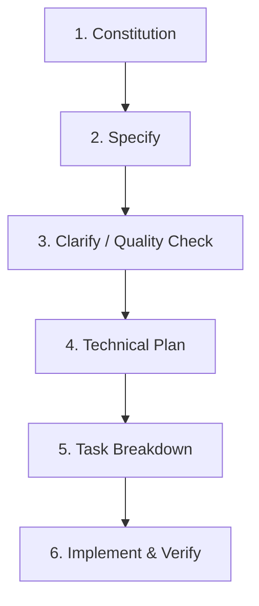

# 📐 GitHub Spec Kit — Spec-Driven Development (SDD)

Framework oficial de ingeniería guiada por especificaciones ejecutables (`github/spec-kit`). Su objetivo es erradicar el *vibe coding* (generación de código a ciegas por prompts sueltos) garantizando que el diseño, los contratos, los datos y las reglas manden siempre sobre la implementación.

Se integra de forma nativa con la directiva global **`SOP_DESARROLLO_APP_CLEAN_SDD`**.

---

## 🚀 1. Ciclo de Vida en 6 Fases



| Fase | Comando / Artefacto | Propósito | Responsable |
| :--- | :--- | :--- | :--- |
| **1. Constitution** | `.specify/memory/constitution.md` | Leyes supremas del proyecto: Clean Architecture, stack autorizado, RLS, 0 alerts nativos. | Usuario + Arquitecto |
| **2. Specify** | `specs/<NNN-feature>/spec.md` | **QUÉ** y **POR QUÉ**. Historias de usuario, criterios de aceptación, requerimientos funcionales y escenarios. *Cero detalles de código*. | Producto / Usuario |
| **3. Clarify** | `specs/<NNN-feature>/checklists/` | Despejar ambigüedades con preguntas directas (máx. 3) antes de diseñar la solución. | Agente |
| **4. Plan** | `specs/<NNN-feature>/plan.md` | **CÓMO**. Arquitectura, modelos de datos, endpoints, contratos, diagramas y validación contra la Constitución. | Agente Técnico |
| **5. Tasks** | `specs/<NNN-feature>/tasks.md` | Desglose atómico secuencial con IDs y checkboxes evaluables (`- [ ] Tarea 1`). | Agente Planificador |
| **6. Implement** | `src/`, `tests/` | Ejecución en bucle TDD (Edit-Test-Fix) tarea por tarea. | Agente Desarrollador |

---

## 🛠️ 2. Comandos CLI (`specify`)

La CLI oficial `specify-cli` está instalada en el sistema (`~/.local/bin/specify`).

### Inicializar un proyecto con Spec Kit

```bash
# En el directorio actual del proyecto:
specify init --here --integration gemini --force --non-interactive

# O para otros agentes / modo genérico:
specify init --here --integration claude --force
specify init --here --integration copilot --force
specify init --here --integration generic --force
```

### Comandos de diagnóstico
```bash
specify check        # Verifica herramientas e integraciones disponibles
specify version      # Versión de Spec Kit y del entorno
specify self check   # Comprueba si hay actualizaciones
```

---

## 📜 3. Estructura Estándar `.specify/`

Cuando un proyecto implementa Spec Kit, mantiene la siguiente organización:

```text
proyecto/
├── .specify/
│   ├── memory/
│   │   └── constitution.md        # Reglas inmutables y no negociables
│   ├── templates/
│   │   ├── spec-template.md       # Plantilla de especificación funcional
│   │   ├── plan-template.md       # Plantilla de diseño y arquitectura técnica
│   │   ├── tasks-template.md      # Plantilla de desglose de tareas atómicas
│   │   └── checklist-template.md  # Plantilla de control de calidad
│   └── scripts/                   # Scripts bash/sh para ramas y automatizaciones
└── specs/
    ├── 001-auth-flow/
    │   ├── spec.md                # Requisitos y casos de uso
    │   ├── plan.md                # Blueprint técnico
    │   ├── tasks.md               # Checklist de ejecución
    │   └── checklists/            # Validaciones de calidad
    └── 002-feature-xyz/
```

---

## 🧩 4. Plantillas Maestras para el Agente

### A. Plantilla `constitution.md` (Constitución Base)
Debe basarse en `SOP_DESARROLLO_APP_CLEAN_SDD`:
1. **Clean Architecture Estricta**: Tres capas (`domain/`, `data/`, `presentation/`). Las vistas nunca llaman directamente a APIs o SDKs de base de datos.
2. **Cero Diálogos Nativos**: Prohibido el uso de `alert()`, `confirm()` o `prompt()`. Todo feedback debe ser visual en el DOM (`toast` o `modal`).
3. **Persistencia & RLS**: Toda tabla en Supabase debe tener Row Level Security activado forzando aislamiento multiusuario (`auth.uid() = user_id`).
4. **Dimensionamiento Rem**: Fuentes y espaciados basados en `10px` (`html { font-size: 62.5%; }`).
5. **Accesibilidad WCAG 2.1 AA**: Botones con `aria-label`, contraste mínimo 4.5:1, áreas táctiles ≥ 48x48dp.
6. **TDD / Compilación Limpia**: Cobertura > 80% en dominio/datos, 0 errores de TypeScript y linter sin advertencias.

### B. Plantilla `spec.md` (Qué y Por Qué)
- **User Scenarios**: "Dado que [contexto], cuando [acción], entonces [resultado esperado]".
- **Functional Requirements**: Requerimientos independientes del stack técnico.
- **Success Criteria**: Métricas medibles (ej. "El cálculo del drawdown se completa en < 50ms").
- **Assumptions & Edge Cases**: Casos de error o estados límite identificados.

### C. Plantilla `plan.md` (Cómo Técnico)
- **Constitution Check**: Tabla de verificación confirmando que el plan respeta cada punto de la Constitución.
- **Arquitectura de Capas**:
  - `domain/entities`: Nuevos tipos e interfaces.
  - `domain/usecases`: Casos de uso atómicos.
  - `data/repositories`: Implementación con Supabase / APIs.
  - `presentation/`: Componentes UI y stores.
- **Database Schema**: Tablas, columnas, índices y políticas RLS (si aplica).
- **Test Strategy**: Tests unitarios y de integración previstos.

### D. Plantilla `tasks.md` (Desglose de Tareas)
```markdown
## Phase 1: Dominio y Tipos
- [ ] T001: Crear interfaces de dominio en `src/domain/entities/...`
- [ ] T002: Implementar casos de uso puros con tests unitarios

## Phase 2: Capa de Datos y Persistencia
- [ ] T003: Crear migración SQL de tabla con RLS
- [ ] T004: Implementar repositorio de datos en `src/data/repositories/...`

## Phase 3: Capa de Presentación e Interfaz
- [ ] T005: Maquetar componentes visuales en `src/presentation/components/...`
- [ ] T006: Conectar vistas a los casos de uso con feedback visual (sin alerts)

## Phase 4: Validación y Verificación
- [ ] T007: Ejecutar suite de tests unitarios (`npm run test`)
- [ ] T008: Verificar compilación completa (`npm run build`)
- [ ] T009: Validar accesibilidad y contrastes
```

---

## ⚡ 5. Regla de Oro del Agente

> **NUNCA comiences a escribir código en una nueva feature o refactor significativo sin tener antes redactados y validados su `spec.md`, su `plan.md` y su lista de `tasks.md`.**
> 
> Si detectas ambigüedad en los requerimientos del usuario, detén el flujo y formula preguntas aclaratorias (máximo 3) antes de generar código.
